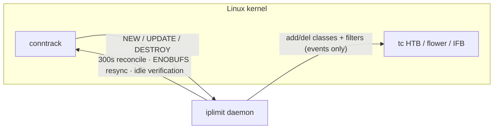

# iplimit-rs

A single-binary Rust rewrite of [sakz/iplimit](https://github.com/sakz/iplimit):
per-client-IP traffic shaping for proxy VPS boxes, with an independent HTB class
for every detected client IP in both directions — built for near-zero idle CPU
and a few megabytes of RSS instead of a polling shell pipeline.

- TCP and UDP, IPv4 and IPv6
- Client discovery straight from the kernel via **ctnetlink** (no `conntrack -E`
  subprocess, no awk/sort pipeline, no periodic full-table polling)
- One static binary, one process, ~2 MB RSS; `systemd` `Type=notify`
- Drop-in replacement for the bash tool: same CLI, same config file, same tc
  topology, same `owner.env`/`clients.tsv` state — it can take over a running
  bash daemon's rules on upgrade
- Safe by construction: refuses foreign root qdiscs, only removes what it owns,
  clean rollback on stop/crash

## Install

```bash
curl -fsSL https://raw.githubusercontent.com/sakz/iplimit-rs/main/install.sh | sudo bash
```

The installer fetches the prebuilt binary for your architecture (amd64/arm64)
from GitHub Releases (built on Debian 12, so it runs on the target's glibc
2.36), falls back to `cargo build` when unavailable or not runnable, and works
the same from a clone (`sudo ./install.sh`). See [docs/deployment.md](docs/deployment.md)
for the full flow, takeover semantics, troubleshooting and uninstall.

If `raw.githubusercontent.com` is unreachable from your network, install from
a clone instead:

```bash
git clone https://github.com/sakz/iplimit-rs.git
cd iplimit-rs && sudo ./install.sh
```

## Use

```bash
sudo iplimit                 # interactive menu
sudo iplimit start 20        # 20 Mbps per client, auto-detect WAN interface
sudo iplimit start 12.5 eth0
sudo iplimit set 50
sudo iplimit status
sudo iplimit clients
sudo iplimit stop
```

Configuration lives in `/etc/iplimit.conf` (`RATE_MBIT`, `INTERFACE`,
`IFB_NAME`, `POLL_INTERVAL`, `CLIENT_TTL`, `UNSHAPED_RATE_MBIT`, `EXCLUDE_IPS`).
`POLL_INTERVAL` is the timer/retry cadence, not a table-poll interval — the
daemon is event-driven either way.

## How it works



- **Discovery**: one netlink socket subscribed to conntrack NEW/UPDATE/DESTROY.
  A new client IP gets its two HTB classes, two `fq_codel` leaves, two flower
  filters and one ingress mirred redirect — the same seven tc operations the
  bash tool performs, just once per client instead of every poll.
- **Overflow safety**: the event socket requests an 8 MB receive buffer via
  `SO_RCVBUFFORCE` (plain `SO_RCVBUF` is silently capped by
  `net.core.rmem_max`, ~208 KB by default). If the buffer still overflows
  (ENOBUFS), the daemon resyncs from a full-table dump — throttled to at most
  one dump per 5 s, with counters rebuilt from the dump itself.
- **Lost DESTROY safety net**: the kernel allocates the conntrack event extension
  lazily at entry creation, so entries created before any listener existed never
  emit DESTROY. Clients that look idle past `CLIENT_TTL` while the daemon still
  counts connections are verified with one targeted dump before reaping.
- **Takeover**: after a crash or an upgrade from the bash version, the daemon
  recognizes its own `owner.env` (`RULESET_VERSION=2`), removes stale ingress
  filters and rebuilds the root HTB queue (del + add — some kernels, e.g. 6.8,
  reject `replace` on an existing HTB root).
- **Cleanup**: SIGTERM/`stop` removes exactly what it created, including the
  IFB device and clsact qdisc if it installed them.

## Performance

Measured in identical Linux network namespaces (Debian 12 container, kernel
6.8), same topology, same traffic; CPU is the total of every process inside the
server namespace, including orphaned pipeline helpers:

| Implementation | Startup | A idle, small table | B client churn (3 IPs, 10 pps) | C 2000-entry table, quiet | D big table, long window | RSS | Resident processes |
|---|---|---|---|---|---|---|---|
| bash original | 0.06 s | 0.042% | 0.075% | 0.042% | 0.057% | ~12.4 MB | 5 + listener |
| iplimit-rs | 0.07 s | 0.008% | 0.242% | 0.025% | 0.021% | ~3.0 MB | 1 + listener |

Windows: A/B/C 120 s each, D 620 s. Configuration at defaults on both sides
(`CLIENT_TTL=300`); the bash tool's periodic full-table resync caps at
`CLIENT_TTL/3` = 100 s, the Rust daemon reconciles every 300 s.

Takeaways:

- **Idle cost is effectively zero for both** event-driven versions; the Rust
  rewrite removes ~10 MB of resident shell/pipeline processes and collapses
  5–6 processes into one ~2 MB static binary.
- Under sustained connection churn both stay below 0.3% of a core. The bash
  tool amortizes event parsing in a persistent `conntrack | awk` helper
  pipeline; the Rust daemon pays a small per-datagram `poll`+`recvmsg` cost
  instead — same order of magnitude, no helper processes to keep alive.
- Full-table safety dumps run in-process at a lower cadence (300 s vs the bash
  tool's effective 100 s cap), so the cost of a busy conntrack table shrinks
  proportionally and without `conntrack | awk | sort` forks.
- Compared to the historical 1.1.x bash daemon (two full-table dumps per
  `POLL_INTERVAL`, a noticeable fraction of a core on busy boxes), the
  steady-state model is event-driven with O(1) idle work.

## Development

```bash
cargo test --release                       # 25 unit tests (netlink codec, tc specs, state)
cargo clippy --release --all-targets -- -D warnings
bash tests/integration.sh                  # privileged netns integration suite
bash tests/perf-compare.sh [window_secs]   # vs. the bash original: CPU/RSS/startup
```

`tests/integration.sh` needs root (or a privileged container) with iproute2,
conntrack, iptables, netcat and nsenter. It verifies discovery, filter/class
layout, IFB upload counters, IPv6 priorities, TTL reaping, graceful SIGTERM
cleanup, crash takeover, and refusal to clobber foreign qdiscs.

## License

MIT
