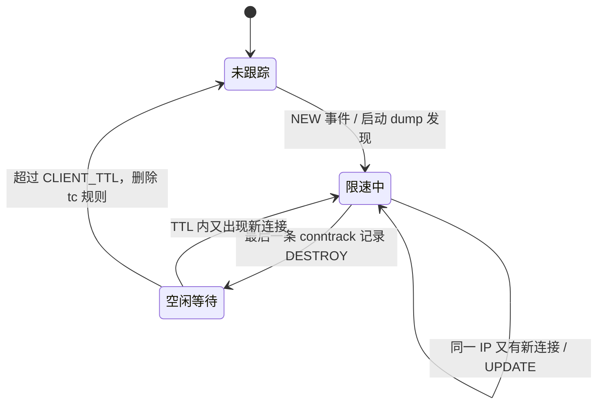

# IPLimit Rust 重写方案

- 状态：方案待确认，尚未开始实施
- 目标仓库：`~/myProject/iplimit-rs`
- 对照实现：`~/myProject/iplimit`，当前 HEAD `15c69ee`（1.1.0）

## 1. 目标与边界

用 Rust 实现与原项目等价的功能，替换原 Bash 守护进程，重点降低常驻 CPU 与内存占用：

- 功能保持：同样的命令行、交互菜单、配置键、状态文件、tc/IFB 拓扑、安全检查、中文提示。
- 行为保持：每个直连客户端 IP 独立上传/下载限速；支持 TCP/UDP、IPv4/IPv6；未识别流量不限速。
- 部署保持：`/usr/local/bin/iplimit`、`/etc/iplimit.conf`、`/run/iplimit/*`、`iplimit.service` 均可原位替换。
- 不做范围外的事：不加 Web 面板、不改限速算法、不引入分布式/多机能力。

## 2. 原实现 CPU 高的根因

先只依据当前仓库代码逐行判断，实际归属在可行性阶段用数据确认。

| 消耗点 | 频率 | 代码位置 | 说明 |
| --- | --- | --- | --- |
| 两次全量 conntrack 导出 | 每 2 秒 | [iplimit:463](file:///Users/saber/myProject/iplimit/iplimit#L463)、[iplimit:596](file:///Users/saber/myProject/iplimit/iplimit#L596) | `conntrack -L -f ipv4` 与 `-f ipv6` 各遍历一次整张 conntrack 表并格式化。表越大越贵，成本是 O(全表)。 |
| awk 逐行解析 | 每 2 秒 | [iplimit:132](file:///Users/saber/myProject/iplimit/iplimit#L132) | `extract_clients` 对整张表每一行做字段扫描。 |
| sort / date / mv / 临时文件 | 每 2 秒 | [iplimit:468](file:///Users/saber/myProject/iplimit/iplimit#L468)、[iplimit:569](file:///Users/saber/myProject/iplimit/iplimit#L569)、[iplimit:607](file:///Users/saber/myProject/iplimit/iplimit#L607) | 即使零新客户端，每轮仍有 `date`、2×`conntrack`、`awk`、`sort`、`sort`、`mv` 等进程创建，约 7 个进程/轮、210 个/分钟。 |
| 每轮重写 clients.tsv | 每 2 秒 | [iplimit:607](file:///Users/saber/myProject/iplimit/iplimit#L607) | 内容不变也重写，产生无意义磁盘与调度开销。 |
| 新客户端建类 | 仅新客户端 | [iplimit:471](file:///Users/saber/myProject/iplimit/iplimit#L471) | 每个新客户端 8 次 `tc` 调用；这是事件级成本，不是常驻成本。 |
| systemd 通知 | 启动一次 | [iplimit:557](file:///Users/saber/myProject/iplimit/iplimit#L557) | 外部进程 `systemd-notify`，只影响启动。 |

结论：原实现的主要问题不是“tc 限速本身”，而是用 Bash 每 2 秒全量拉取并解析 conntrack。当前 1.1.0 已经把 IFB 重定向收窄到“已发现客户端的源 IP”([iplimit:501](file:///Users/saber/myProject/iplimit/iplimit#L501))，数据面比 1.0.0 轻，控制面轮询仍然是常数级高开销。

需要特别区分的一点：如果线上高占用落在 `ksoftirqd` 而不是 `bash/awk/conntrack`，那属于数据面包处理成本，仅重写控制面不会消除。可行性阶段先做归属测量，再决定是否要追加数据面优化。

## 3. 总体架构

```mermaid
flowchart LR
    systemd[iplimit.service] --> daemon[iplimit daemon-internal]
    daemon -->|启动时全量 dump| ctnl[(ctnetlink socket)]
    ctnl -->|NEW / DESTROY 事件| daemon
    daemon -->|客户端增删| tc["tc / ip 子进程"]
    daemon -->|owner.env / clients.tsv| run[/run/iplimit]
    cli["iplimit start/status/stop/clients"] --> systemctl[systemctl]
    cli --> tc
```

单线程事件循环，没有 async 运行时：

- 一个 `NETLINK_NETFILTER` socket 订阅 conntrack 的 NEW / UPDATE / DESTROY 组。
- 一个 timerfd 管理最近的下一次空闲回收/对账时间。
- 一个 self-pipe / signalfd 处理 SIGTERM、SIGINT。
- 用 `poll(2)` 阻塞等待；空闲时不轮询、不创建进程。

客户端状态机：



## 4. 客户端发现：从“轮询全表”改为“内核事件 + 少量对账”

发现规则与原实现一致：只看 conntrack 原始方向，`dst` 是本机该网卡的全局地址、`src` 不是本机地址，且协议是 TCP 或 UDP，则 `src` 是客户端 IP。

维护方式：

- 启动时：先订阅事件，再做一次流式全量 dump，只累计每个客户端 IP 的活跃记录数，不保存整表。
- NEW 事件（带 `NLM_F_CREATE`）：对应 IP 记录数 +1；首次出现则立即建类。
- UPDATE 事件：只刷新最后活跃时间，不重复建类。内核用 `NLM_F_CREATE` 区分新建与更新。
- DESTROY 事件：对应 IP 记录数 -1；降到 0 后进入 `CLIENT_TTL` 空闲计时。
- 空闲回收：只有记录数持续为 0 超过 `CLIENT_TTL` 才删类，与原实现“conntrack 里看不到该 IP 一段时间后清理”的语义一致。
- 事件丢失兜底：socket 收到 `ENOBUFS`，或每 300 秒，做一次 in-process 对账 dump，重置每个 IP 的记录数。相比原来每 2 秒全表导出，频率降低 150 倍，而且不再创建 `conntrack/awk/sort` 进程。
- DESTROY 丢失核实：实测（内核 6.8）发现 DESTROY 事件不可靠——conntrack 事件扩展是在条目**创建时**按当时 ctnetlink 监听器数量惰性分配的，建档时没有监听器的条目到期消失时不会补发 DESTROY，连接计数会虚高、客户端被判为永久活跃。因此每个轮询 tick 前，对「空闲超过 TTL 但计数仍 >0」的客户端做一次定向 dump 核实，以内核真实表重置计数；稳态下无此类客户端，不产生额外 dump。
- 建类失败重试：沿用 `POLL_INTERVAL` 作为重试间隔，避免一次 tc 瞬态失败后该客户端长期漏限速。
- 类别 ID：10–65000，优先复用已释放的 ID；新分配从 10 开始递增，和原实现的可观察行为一致。

为什么用 ctnetlink 而不是 `conntrack -E`：

- 直接读内核原生事件，不需要长期挂一个外部进程，也没有文本格式化/解析成本。
- 启动 dump 在进程内完成，不依赖 `conntrack` 命令，安装依赖可以少一项。
- `conntrack -E` 只作为可行性阶段的对拍工具，不作为生产实现。

为什么数据面仍调用 `tc` / `ip` 子进程：

- 只在“服务启动/停止、客户端新增/删除”时调用，不在每轮轮询里调用；原实现的 CPU 大头是每 2 秒全表导出，不是这些事件级的 tc 调用。
- 直接复用现有 tc 语法，能逐条复刻 htb/flower/mirred 拓扑和安全检查，避免手写 netlink 编码引入难以排查的偏差。
- 可行性阶段会实测单客户端建类耗时和突发客户端场景；如果实测证明客户端频繁增删时 tc 进程开销不可接受，再评估迁移到 rtnetlink。

为什么不用 eBPF：

- eBPF 能进一步降低发现成本，但需要额外解决内核 BTF、加载权限、编译工具链和部署兼容性；ctnetlink 已经能把常驻发现成本降到事件级，收益不足以抵消复杂度。
- 数据面仍是 tc，eBPF 只能替换发现，不能替代本方案的核心目标。

为什么不用 tokio/async：

- 只需要监听 3 个 fd，单线程阻塞 `poll` 更简单、内存更小、没有运行时调度开销。

## 5. 功能兼容清单

| 项目 | 兼容要求 |
| --- | --- |
| 命令 | `start [Mbps] [网卡]`、`set <Mbps>`、`status`、`clients`、`stop/clean`、`help`、`version`、无参数交互菜单、内部 `daemon-internal` / `cleanup-internal` |
| 配置 | `/etc/iplimit.conf` 的 `RATE_MBIT`、`INTERFACE`、`IFB_NAME`、`POLL_INTERVAL`、`CLIENT_TTL`、`UNSHAPED_RATE_MBIT`、`EXCLUDE_IPS` 全部生效；兼容 `IPLIMIT_CONFIG_FILE`、`IPLIMIT_STATE_DIR` 环境变量 |
| 状态文件 | `owner.env` 保持 `INTERFACE/IFB_NAME/CREATED_CLSACT/RULESET_VERSION=2`；`clients.tsv` 保持表头与 `IP<TAB>1:hex<TAB>时间戳` 格式 |
| tc 拓扑 | WAN 根 htb `1:` default 1、默认类 `1:1` 高速率、`fq_codel 2:`；每个客户端在 WAN 和 IFB 各有独立 htb 类 + fq_codel；WAN egress 按 `dst_ip` 分类下载，IFB 按 `src_ip` 分类上传；WAN ingress 只把该客户端 `src_ip` 重定向到 IFB。崩溃重启接管时根队列采用「先 del 再 add」而非 `replace`：实测内核 6.8 对已存在的 htb 根执行 replace 会报 "Change operation not supported by specified qdisc" |
| 过滤器 | IPv4 共用 pref 49150，IPv6 共用 pref 49151；handle 使用类别号十六进制；保留对 1.0.0 遗留 pref 49152 全局 matchall 的接管清理 |
| 安全检查 | 拒绝覆盖非本工具所有的根 qdisc；拒绝占用被外部使用的 49150/49151；拒绝接管非本工具所有的 IFB；只清理自己创建的规则 |
| 输出 | 关键中文提示、帮助、菜单、错误信息保持原样或等价，便于现有排障习惯 |
| 服务 | 保持 `Type=notify`、`ExecStopPost=iplimit cleanup-internal`、`Restart=on-abnormal`；启动完成后发 READY |

## 6. 性能预算（可行性阶段用实测确认）

- 空闲：无周期性全表扫描、无子进程；目标 systemd 统计 CPU 接近 0%，只保留事件与下一次 TTL 定时器。
- 启动：一次全量 dump，O(conntrack 表大小)；之后不再周期性全量导出。
- 新客户端：8 次 tc 调用 + 一次状态文件写入，成本与客户端数无关。
- 对账：每 300 秒一次进程内 dump，或事件队列溢出时触发。
- 内存：目标 1 万客户端时 RSS < 10 MB，6.5 万客户端时 < 20 MB；状态只保存活跃客户端，不保存整张 conntrack 表。
- 数据面：tc 规则与 1.1.0 等价，不承诺数据面 CPU 会因重写而变化；单独测量 `ksoftirqd`。

## 7. 可行性验证（下一步，需你确认后执行）

环境：

- 本机 Colima/Docker 起 `debian:12` 特权容器，验证 tc/IFB/netns/conntrack 行为。
- 如容器内 `ifb` 或 systemd 行为不完整，改用 Lima 起 Debian 12 虚拟机做同等验证。
- 最终以你的 Debian 12 线上机只读诊断输出为准。

验证项：

1. **CPU 归属**：在容器内构造 1 万/5 万条 conntrack 记录，分别测量原脚本空转 60 秒的 CPU、子进程数量、单次 `conntrack -L` 耗时、`ksoftirqd` 占用。
2. **事件驱动原型**：写一次性 Rust 探针，验证 ctnetlink 订阅、dump、NEW/DESTROY 解析、`NLM_F_CREATE` 区分、DESTROY 是否带原始元组；测空转 CPU、dump 耗时、RSS、事件延迟。
3. **tc 对拍**：在同一 veth/netns 上分别用原脚本和新探针建/删客户端，逐项对比 `tc filter show` / `tc class show` / `tc qdisc show` 输出与清理结果，包括外部规则保留。
4. **兼容性**：原版 `start` 产生的 `owner.env`/tc 状态能否被新版接管并清理；新版产生的状态能否被原版 `stop` 清理。
5. **构建**：用容器交叉/原生构建 `linux/amd64` 与 `linux/arm64` 二进制，确认 Debian 12 glibc 下可运行。
6. **线上只读诊断**：请你在 VPS 上执行以下只读命令并贴回输出，不做任何变更：
   ```bash
   mpstat -P ALL 1 5
   pidstat -u 1 5
   ps -eo pid,ppid,comm,%cpu --sort=-%cpu | head -20
   sudo conntrack -C
   sudo journalctl -u iplimit.service -n 50 --no-pager
   sudo tc -s filter show dev <网卡> ingress | head -40
   ```

验证结论单独写入 `_docs/plans/2026-10-26-iplimit-rs-可行验证.md`，包含环境、命令、原始输出、结论和遗留风险；一次性容器与探针验证后清理，不进仓库。

决策门槛：如果线上 CPU 主要落在 `ksoftirqd`/数据面，而不是 `bash/awk/conntrack`，则先调整数据面方案，不直接进入实现。

## 8. 实施步骤（可行性验证通过后）

1. 在 `iplimit-rs` 初始化仓库，建实施分支。
2. 模块划分：
   - `cli`：参数解析、命令分发、交互菜单。
   - `config`：配置解析/校验/保存，保持原键名和语义。
   - `state`：`owner.env`、`clients.tsv` 原子写。
   - `network`：网卡识别、本机地址、tc/ip 建删、安全检查、IFB 生命周期。
   - `conntrack`：netlink 订阅/dump/事件解析、ENOBUFS 对账。
   - `daemon`：客户端表、类别分配、TTL 回收、事件循环、信号、sd_notify。
3. 测试：
   - 单元测试：IP/速率/网卡名校验、配置解析、conntrack 消息解析（用真实抓包字节）。
   - 集成测试：特权 Debian 12 容器 + netns + veth，跑真实 daemon，检查 tc 状态、事件增删、TTL 回收、外来规则保留、清理幂等。
   - 兼容测试：新旧版本互相接管/清理。
   - 性能回归：同样的 conntrack 规模下对比 CPU、进程数、RSS。
4. 构建产物：release + LTO + strip，提供 amd64/arm64。
5. 交付 `install.sh`、`iplimit.service`、README、部署与回滚文档。
6. 完成后 `git add` 暂存给你审核，不自动 commit。

## 9. 风险与回滚

- tc/网卡变更可能影响远程连接：沿用原安全检查；操作前保留第二个 SSH 会话；`stop` 保持幂等。
- ctnetlink 权限/内核能力不足：启动阶段失败要清理已改动的网络状态；不静默降级到高 CPU 轮询。
- 事件丢失：ENOBUFS + 300 秒对账兜底；失真是延迟回收，不会误删仍在活跃的客户端（回收还受 CLIENT_TTL 保护）。
- 内核差异：以 Debian 12 内核为基线验证 htb/flower/IFB/conntrack 行为。
- 回滚：保留原 `/usr/local/bin/iplimit` 备份；新版 `stop` 后即可装回原版；两侧状态文件格式一致，需双向验证。
- 如果数据面仍是 CPU 大头：重写控制面无法解决，回到方案阶段追加数据面优化，而不是宣称已完成降 CPU。

## 10. 待你确认

1. 是否按本方案进入“可行性验证”（不改线上，只做一次性容器/探针和只读诊断）？
2. 部署方式是否采用“本机交叉编译出 amd64/arm64 二进制 + install.sh 安装”，而不是在服务器上装 Rust 编译？
3. 版本号是否用 `2.0.0` 表示实现替换，同时保持配置/状态/CLI 兼容？
