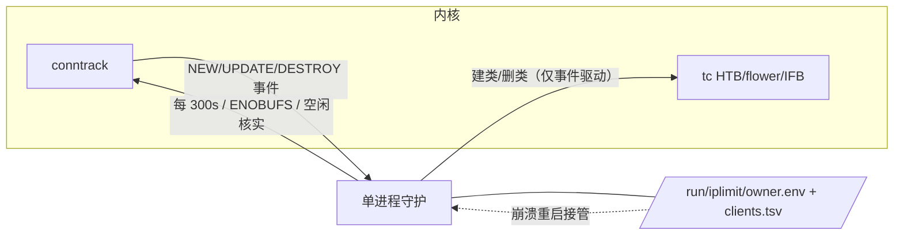

# iplimit-rs 部署文档

面向 Debian 12 / Ubuntu 22.04+（systemd + HTB/flower/IFB/conntrack 齐备的发行版）。
本文覆盖一键安装、升级、日常操作、排障与卸载。

## 一键安装

```bash
curl -fsSL https://raw.githubusercontent.com/sakz/iplimit-rs/main/install.sh | sudo bash
```

在无法访问 `raw.githubusercontent.com` 的网络环境，改用克隆安装
（安装器会直接使用仓库内的 `iplimit.service`，二进制仍从 GitHub Release 下载）：

```bash
git clone https://github.com/sakz/iplimit-rs.git
cd iplimit-rs && sudo ./install.sh
```

安装器行为：

1. `apt-get` 安装依赖：iproute2、conntrack、kmod、systemd、curl、tar。
2. 下载 GitHub Release 中对应架构（amd64/arm64）的预编译二进制
   （Release 二进制在 Debian 12 容器内构建，兼容 Debian 12 的 glibc 2.36）；
   下载失败或二进制无法在本机运行时，回退 `IPLIMIT_FROM_SOURCE=1`
   路线（下载源码 tarball 并 `cargo build --release`）。
3. 原子写入 `/usr/local/bin/iplimit` 与 `/etc/systemd/system/iplimit.service`。
4. 首次安装生成 `/etc/iplimit.conf` 默认配置（已存在则不动）。
5. 若服务正在运行（包括旧版 bash 实现升级上来），`systemctl restart iplimit`，
   新版守护进程会接管旧版留下的 tc 配置与 `owner.env` 状态。

```mermaid
flowchart TD
    A[curl | sudo bash] --> B{apt-get 可用?}
    B -- 否 --> B2[SKIP_DEPENDENCIES=1\n手动准备依赖]
    B -- 是 --> C[安装 iproute2/conntrack/kmod/systemd]
    C --> D{IPLIMIT_FROM_SOURCE=1?}
    D -- 否 --> E[下载 release 二进制\nlinux-amd64 / linux-arm64]
    E -- 失败 --> F
    D -- 是 --> F[源码 tarball + cargo build --release]
    E --> G[原子写入 /usr/local/bin/iplimit + service]
    F --> G
    G --> H{已有 /etc/iplimit.conf?}
    H -- 否 --> I[写入默认配置]
    H -- 是 --> J[保留现有配置]
    I --> K{服务正在运行?}
    J --> K
    K -- 是 --> L[systemctl restart\n接管旧 tc 状态]
    K -- 否 --> M[完成：sudo iplimit start 20]
    L --> M
```

## 日常操作

```bash
sudo iplimit                 # 交互式菜单
sudo iplimit start 20        # 每客户端 20 Mbps，自动识别公网网卡
sudo iplimit start 12.5 eth0 # 指定速率与网卡
sudo iplimit set 50          # 修改速率并重启服务
sudo iplimit status          # 服务/网卡/IFB/根队列/客户端一览
sudo iplimit clients         # 已发现客户端与类别 ID
sudo iplimit stop            # 停止并清理本工具创建的 tc/IFB/状态
```

配置项（`/etc/iplimit.conf`，修改后 `sudo iplimit start` 生效）：

| 键 | 默认 | 含义 |
| --- | --- | --- |
| `RATE_MBIT` | `20` | 每个客户端每方向上限（Mbps，支持小数） |
| `INTERFACE` | `auto` | 公网网卡；`auto` 取默认路由网卡 |
| `IFB_NAME` | `ifb-iplimit` | 上传整形用的 IFB 设备名 |
| `POLL_INTERVAL` | `2` | 定时器/建类重试节奏（秒），不是全表轮询 |
| `CLIENT_TTL` | `300` | 无活跃 conntrack 连接后保留类别的空闲时长（秒） |
| `UNSHAPED_RATE_MBIT` | `100000` | 默认类 `1:1` 的高速上限，未识别流量不受限 |
| `EXCLUDE_IPS` | 空 | 空格分隔的免整形地址 |

## 运行模型与接管



- 守护进程崩溃或服务器重启后再次 `start`：识别 `owner.env` 中
  `RULESET_VERSION=2` 即接管残留的过滤器与类别，先删后建重建根队列。
- 事件套接字申请 8 MB 缓冲（root 下用 `SO_RCVBUFFORCE` 绕过
  `net.core.rmem_max` 的静默截断）。缓冲仍溢出（ENOBUFS）时做全表重同步，
  并限制为每 5 秒最多一次；被跳过间隔里的事件由下一次重同步或周期
  reconcile 整体重建计数。
- 客户端状态文件 `clients.tsv` 最多每秒写一次，高事件率下不产生写盘风暴。
- DESTROY 事件可能因内核事件扩展的惰性分配而丢失：空闲超过 TTL 但计数仍为正的
  客户端，会以一次定向全表 dump 核实，避免永久误判为活跃。
- 外部根队列（CAKE/TBF/别人的 HTB）会被拒绝覆盖；`iplimit stop` 只清理自己创建的对象。

## 排障

```bash
sudo iplimit status
sudo journalctl -u iplimit.service -n 100 --no-pager
sudo tc -s class show dev <公网网卡>
sudo tc -s class show dev ifb-iplimit
sudo conntrack -L -p udp
```

- 服务起不来：systemd `ExecStopPost=iplimit cleanup-internal` 会自动回滚本工具创建的状态。
- 状态残留：`sudo iplimit stop` 幂等，可清掉崩溃后遗留的 tc/IFB/状态文件。
- 客户端不被限速：确认客户端源 IP 真实可见（CDN/反代之后无效），
  并检查 `EXCLUDE_IPS`；`iplimit clients` 里没有该 IP 即未被发现。

## 卸载

```bash
sudo iplimit stop
sudo rm -f /usr/local/bin/iplimit /etc/systemd/system/iplimit.service
sudo systemctl daemon-reload
# 配置 /etc/iplimit.conf 按需删除
```

依赖包（iproute2 等）保留，不主动卸载。
